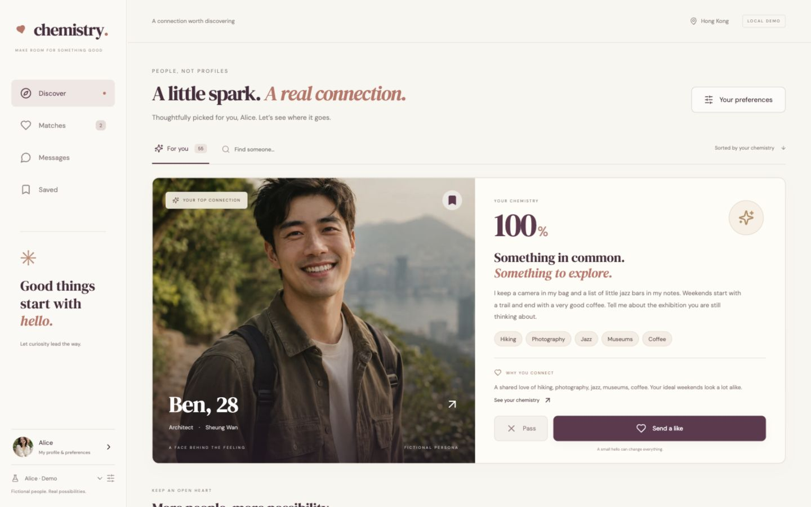

# Chemistry

**More than a match. Find your chemistry.**

A desktop-first, responsive dating application for the University of Hong Kong COMP3278 relational database final project. Every profile is fictional. This is a local demonstration with an account switcher, not production authentication.



## Quick start

### Option A: Docker (one command)

Prerequisite: Docker Desktop with Compose.

```bash
docker compose up --build
```

Open **http://127.0.0.1:3000**. The first start creates and seeds MySQL. Later starts preserve your data. The application is published only on loopback. MySQL has no published port. Demo credentials in Compose are intentionally local and must never be used for a public service.

Stop with `docker compose down`. Reset using **LOCAL DEMO → Reset demo** in the app, or `docker compose exec app pnpm db:reset`. The reset is destructive to this demonstration's data and requires `DEMO_MODE=true`.

The native startup and clean MySQL setup were exercised in the build environment. Docker is supplied as a reproducible alternative but was not run here because Docker is not installed.

### Option B: Node and an existing MySQL installation

Prerequisites: Node.js 22 or newer, pnpm 11.25.0, and MySQL 8.0.16 or newer (tested with 8.4.11). Install pnpm with `npm install -g pnpm@11.25.0` if needed.

1. Create a dedicated local database and account using your MySQL administrator:

```sql
CREATE DATABASE chemistry CHARACTER SET utf8mb4 COLLATE utf8mb4_unicode_ci;
CREATE USER 'chemistry'@'localhost' IDENTIFIED BY 'change-me-local-only';
GRANT ALL PRIVILEGES ON chemistry.* TO 'chemistry'@'localhost';
```

2. Copy `.env.example` to `.env`. Set the host, port, username and password for that account. Keep `DB_NAME=chemistry` and `DEMO_MODE=true`. The file is ignored by Git.

3. Install, initialize and launch:

```bash
pnpm install --frozen-lockfile
pnpm db:setup
pnpm dev
```

Visit **http://127.0.0.1:3000**. `pnpm db:setup` recreates the demo schema and resets all data; do not run it against a database you want to preserve.

For a production frontend build, run `pnpm build`, then `NODE_ENV=production pnpm start`. The app is still a local fictional-user demo. `./scripts/start-local.sh` builds and launches it while preserving an existing schema.

### On the Mac used to build this project

Double-click **Launch Chemistry.command**, or run `./scripts/start-local.sh`. The script can use Codex's bundled Node and the isolated MySQL runtime already downloaded under the task's `work/runtime` directory. It does not install a system service. The prepared, ignored `.env` uses port 3307. This convenience path is specific to the delivered workspace; a fresh Git clone should use Option A or B.

Keep the terminal open while presenting. Control-C stops the web server. The isolated MySQL process can be stopped with its `mysqladmin --socket=<task>/work/runtime/mysql.sock -u root shutdown` command. No personal databases are used.

## What works

- Welcome page and ranked Discover with actual SQL scores, shared-interest explanations, like/pass and saved profiles.
- Profile detail with the score's five components and galleries for Alice, Ben and Chris.
- Profile creation, biography/lifestyle editing, interests and reciprocal age/gender preferences.
- Directional likes, transactional mutual matching and duplicate prevention.
- Match list, persisted conversations, account switching and unmatch.
- Saved/unsaved profiles, including idempotent duplicate requests.
- A separate Demo Studio with live row counts, actual committed-operation results, row inspection and a confirmed reset.
- Local fonts and portrait assets. No external APIs, authentication provider, paid service or network access is needed after setup.

Pass only dismisses a profile for the current browser session. Likes do not automatically remove candidates before a match; their button changes to “Like sent.” Existing matches are excluded from discovery.

## Exact two-minute demo

Start with **LOCAL DEMO → Reset demo**, confirm, and use Alice. The seed is deterministic.

1. **CREATE:** Open LOCAL DEMO → Create fictional profile. The short form contains a fictional Robin example. Click Create. Studio now shows user 65 and related rows. Switch to Alice.
2. **READ:** Discover shows Ben at **100%**, above Chris at **43%**. Open “See your chemistry.” Ben has all five shared interests and the matching weekend/social preferences.
3. **UPDATE:** Open Your preferences. Deselect **Hiking, Photography, Jazz, Museums**. Keep **Coffee**. Select **Gaming, Cooking, Cinema, Board games**. Set **Their ideal weekend = Cozy** and **Their social energy = Quiet**. Save. Chris is now **100%** and Ben **43%**. Alice's own lifestyle need not change.
4. **CREATE / READ:** Search Discover for **Ben**, then Send a like. Ben's seeded reverse like already exists. The celebration appears and the match count increases by one. The account-switch dropdown can demonstrate either side of the relationship.
5. **CREATE / READ:** Say hello. Send “Coffee and a jazz night?” Reload. The conversation reopens and the message remains.
6. **DELETE:** Click Unmatch, then confirm. Ben disappears from Matches. The match and messages are deleted, together with both directional likes. Studio shows the resulting real rows and counts.

With Robin created, the final counts are **65 users, 219 likes, 20 matches, 80 messages**. Saved profiles remain 90 unless you also demonstrate unsaving. Reset restores 64 users, 220 likes, 20 matches, 80 messages and 90 saves.

The detailed timing, narration and recording checklist are in `presentation/storyboard/` and `presentation/scripts/`. A full presentation is five minutes, including a maximum two-minute demo video. Role assignments cover groups of three, four or five people without invented member names.

## Architecture

React 19 + TypeScript + Vite frontend → Express API → `mysql2` parameterized SQL → MySQL. A small query/repository layer keeps the SQL visible. No ORM or browser-local persistent data substitutes for database writes. Browser storage remembers only the selected demo account, page and open conversation.

The API binds to `127.0.0.1` by default. Compose binds the container internally to all interfaces but publishes only the host's loopback port. Cross-origin browser requests are rejected. All API routes require `DEMO_MODE=true`; anyone who can reach the local API can switch fictional users. This intentionally has no production authentication.

## Database and integrity

Ten tables:

| Table | Purpose and important constraints |
| --- | --- |
| `users` | User identity, integer primary key |
| `profiles` | One-to-one user profile, adult age CHECK, separate gender/presentation fields, local image and JSON photo paths |
| `preferences` | One-to-one discovery settings, valid inclusive age range |
| `preference_genders` | Composite key `(user_id, gender)`, explicit selected genders |
| `interests` | Unique interest names |
| `user_interests` | Many-to-many junction, composite primary key |
| `likes` | Directional composite key, no self-like, foreign keys at both ends |
| `matches` | Canonical `user_a < user_b`, unique unordered pair, indexed participant tuple |
| `messages` | Composite FK `(match_id,user_a,user_b)` to the existing match; CHECK requires sender to be one of those users |
| `saved_profiles` | Directional composite key, no self-save |

User deletion cascades to dependent data. Interest deletion is restricted while referenced. Match deletion cascades to messages. **Unmatch also explicitly deletes both directional likes in the same transaction**, preventing an immediate phantom rematch. Saved profiles survive unmatch. Existing matches remain if either person later edits preferences; reciprocal eligibility is enforced when discovering or creating a new match.

Profile creation/update, like/match creation, message writes and unmatch use transactions. The like transaction locks the two user rows in ascending order, preventing concurrent reciprocal requests from racing. API calls are serialized for this small local demo so schema reset cannot overlap an in-flight operation. Reset uses MySQL DDL (which auto-commits), followed by transactional seed insertion; a setup interruption should be repaired by rerunning reset.

SQL enforces sender membership, foreign keys, duplicate pairs and self-relationship checks. The repository enforces reciprocal eligibility and the relationship between mutual likes and matches. Direct administrator SQL can bypass those application-level invariants, so write through the app or use the documented transactional examples.

## Explainable compatibility

The database first filters candidates using **both users' age ranges and selected dating genders**, then excludes self and existing matches. Visual presentation never determines eligibility.

| Component | Points |
| --- | ---: |
| Shared interests / larger of the two interest counts | Up to 40 |
| Candidate weekend equals viewer's desired weekend | 15 |
| Candidate social energy equals viewer's desired social energy | 10 |
| Reciprocal age and gender eligibility | 25 |
| Same broad district | 10 |

The total is rounded to an integer and sorted descending, then by user ID for ties. Eligible candidates range from 25 to 100; ineligible people never receive a displayed score. The 25 eligibility points are intentionally constant among eligible recommendations. This is an explainable classroom scoring model, not a measured probability of relationship success.

The full query is **`database/queries/discovery.sql`**, executed verbatim. It uses multiple joins, a many-to-many intersection, `COUNT`, `GROUP_CONCAT`, `GROUP BY`, `EXISTS`, `NOT EXISTS`, conditional expressions and `ORDER BY`.

The presentation highlights:

- **SQL A:** compatibility ranking, shared-interest aggregation and reciprocal filtering.
- **SQL B:** self-join of directional likes to detect both directions; canonical unique pair insertion.
- **SQL C:** preference and interest updates.
- **SQL D:** unmatch cleanup and cascading message deletion.
- **SQL E:** transactional profile creation and junction-table inserts.

Executable examples and annotations are in `presentation/sql/`. The measured before/after values are exported by the integration test to `presentation/data/rankings.json`.

## Seed data and images

`database/seed-generator.ts` creates `database/seed.sql` reproducibly with 64 adults aged 21–35, 32 feminine-presenting portraits and 32 masculine-presenting portraits. Gender identity and selected dating genders are independent fields. There are 28 interests, 5–9 interests per seeded user, 220 directional likes, 20 reciprocal matches, 80 messages and 90 saved profiles. Handwritten biographies and occupation mappings are in `database/personas.ts` and the generator. Biography topics inform the seeded interest associations.

All portraits are AI-generated fictional adult imagery, not photos of actual members. The manifest under `public/profiles/` records the exact prompts, profile mapping, local files and validation metadata. The fixed seed uses these committed assets; regenerating AI images is not deterministic. New demo profiles use a clearly disclosed sample portrait. DM Sans and DM Serif Display are stored locally with their SIL Open Font Licenses.

## Presentation deliverables

`presentation/` contains the editable deck and its authoring source, simplified and technical ER sources and SVG/PNG exports, highlighted SQL assets, architecture/CRUD diagrams, measured personalization graphic, screenshots, timed narration, role assignments and recording instructions. See its own README for the final file index and any video-draft limitations.

## Tests and verification

```bash
pnpm build
pnpm test
```

**Warning:** integration tests reset the configured demo database. Use an isolated schema such as `DB_NAME=chemistry_test pnpm test` when preserving a rehearsal state. Your database account must have permission for that schema. Tests deliberately restrict reset to names beginning with `chemistry`.

Tests cover seed counts and reciprocal eligibility, real ranking changes, profile creation and rollback, self/invalid/ineligible likes, concurrent duplicate likes, match uniqueness, sender membership in both API and SQL, message persistence, save/unsave, unmatch cascades, invalid foreign keys and repeated deterministic resets. Asset validation checks all portrait files and hashes. Browser rehearsal covers desktop (1440×900), mobile (390×844), the full CRUD flow, navigation and console errors.

## Structure

```text
src/                 React UI, shared types and Express SQL repository
database/            Schema, deterministic generator, SQL seed and ranking query
public/              Local portraits, fonts and brand mark
scripts/             Startup, asset validation and presentation generation
tests/               MySQL integration and HTTP validation
presentation/        Editable slides, diagrams, SQL, screenshots and timed scripts
```

## Troubleshooting

- **Database unavailable / connection refused:** start MySQL and check `.env`. The prepared workspace uses 3307, normal MySQL typically uses 3306. Docker uses the internal hostname `db`.
- **Access denied:** make the `.env` user/password and grants agree. MySQL treats host-based accounts separately.
- **Unknown database / missing tables:** create the schema/account, then run `pnpm db:setup` with demo mode enabled.
- **Port 3000 in use:** stop the earlier app process or set `PORT=3001` in `.env` and use that URL.
- **Reset refused:** keep `DEMO_MODE=true` and a `chemistry` or `chemistry_*` schema name. This guard prevents accidental use against unrelated databases.
- **No candidates:** broaden reciprocal age/gender preferences or reset. Passes can be cleared with Explore again or account switching.
- **Ben will not match:** reset first. Unmatch deliberately removes Ben's seeded reverse like; it must exist for the scripted mutual match.
- **Old selected profile after an external database reset:** reload and choose Alice. In-app reset handles this automatically.
- **Docker first boot takes time:** the database health check must pass, dependencies must install, and the frontend must build.
- **macOS launcher is not executable after copying:** run `chmod +x 'Launch Chemistry.command' scripts/start-local.sh`, then run it from Terminal.

Official runtime source: [MySQL Community Server 8.4](https://dev.mysql.com/downloads/mysql/8.4.html). No runtime binaries, passwords or database data directories are committed.
